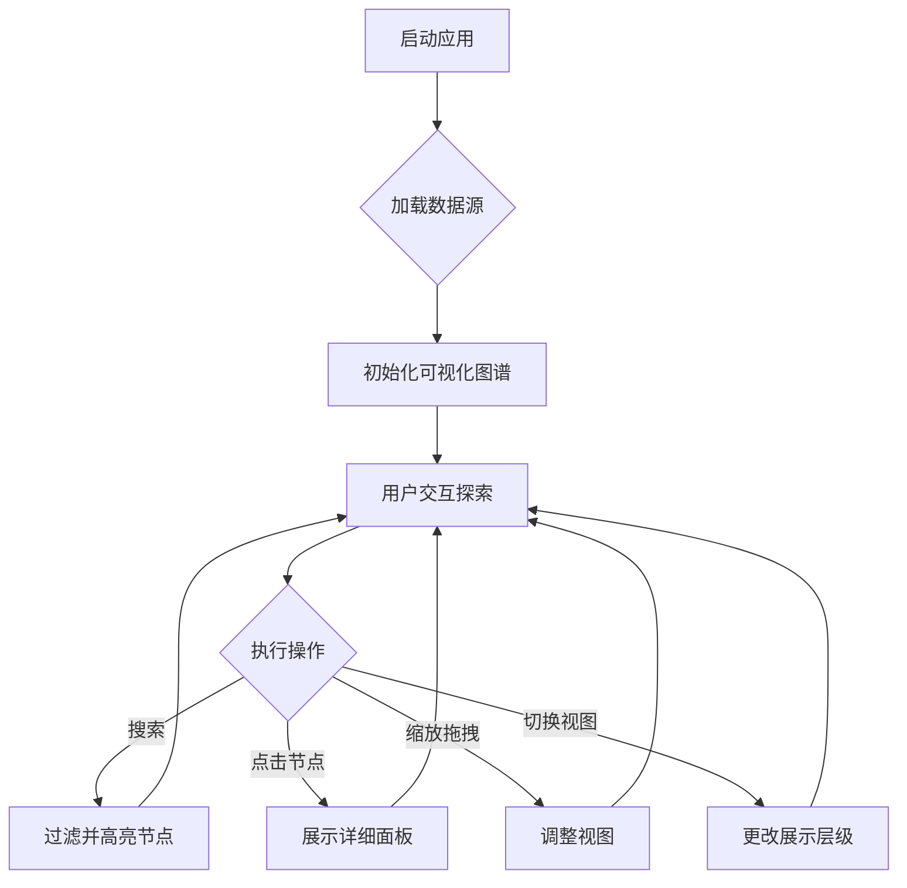

# 代码知识图谱可视化平台 PRD

## 1. 产品概述

一个专为百万行级ArkTS/HarmonyOS项目设计的交互式代码知识图谱可视化平台。通过先进的图形可视化技术，让开发者能够直观地探索和理解复杂的代码结构、类关系、方法调用链和组件嵌套关系。

**核心价值**：
- 将枯燥的代码结构转化为直观、生动的可视化图形
- 帮助开发者快速理解大型项目的架构
- 支持代码变更追踪和增量更新可视化
- 提供智能搜索和过滤功能

## 2. 核心功能

### 2.1 用户角色
本平台面向HarmonyOS/ArkTS开发者，特别是处理大型项目的团队。

### 2.2 功能模块

1. **交互式图谱可视化**
   - 力导向图展示代码结构
   - 支持拖拽、缩放、平移操作
   - 节点颜色编码（类、方法、组件）
   - 连线动画展示调用关系

2. **多层级视图**
   - 文件级别视图
   - 类级别视图
   - 方法级别视图
   - 组件嵌套视图

3. **搜索和过滤系统**
   - 按名称搜索类、方法、文件
   - 按类型过滤节点
   - 高亮路径追踪
   - 收藏常用视图

4. **详细面板**
   - 节点详情展示（定义、位置、引用次数）
   - 方法调用链追踪
   - 组件依赖关系
   - 代码片段预览

5. **性能指标仪表板**
   - 项目统计概览
   - 代码复杂度分析
   - 文件大小分布
   - 类和方法数量趋势

## 3. 核心流程

### 3.1 主用户流程

### 3.2 数据加载流程

## 4. 用户界面设计

### 4.1 设计风格
- **主题**：暗色科技风格，灵感来自宇宙星空和神经网络
- **主色调**：深空蓝 (#0a0e27) 配合电光蓝 (#00d4ff) 和霓虹紫 (#8b5cf6)
- **按钮风格**：玻璃拟态效果，带发光边框
- **字体**：JetBrains Mono（代码）、Outfit（UI）
- **布局**：全屏沉浸式图谱 + 侧边控制面板

### 4.2 页面设计

| 页面/模块 | 元素 | 描述 |
|-----------|------|------|
| 图谱视图 | 主画布 | 全屏WebGL Canvas，支持10万+节点渲染 |
| 控制面板 | 左侧边栏 | 搜索框、过滤器、视图切换器 |
| 详情面板 | 右侧滑出 | 节点详情、代码预览、调用链 |
| 统计面板 | 底部抽屉 | 性能指标、图表、趋势线 |
| 导航栏 | 顶部 | Logo、项目选择、设置、主题切换 |

### 4.3 视觉效果
- 节点：圆形渐变 + 外发光效果
- 连线：贝塞尔曲线 + 流动动画
- 背景：星云粒子效果 + 网格线
- 交互：涟漪反馈 + 缩放弹性动画
- 加载：骨架屏 + 脉冲动画

### 4.4 响应式设计
- 桌面优先，支持平板横屏
- 移动端简化视图（列表模式备选）

## 5. 技术亮点

- **WebGL渲染**：使用Pixi.js实现高性能图形渲染
- **力导向布局**：D3-force算法优化，支持百万节点
- **增量渲染**：虚拟列表 + LOD细节层次
- **实时搜索**：模糊匹配 + 高亮追踪
- **主题系统**：支持明暗主题切换
