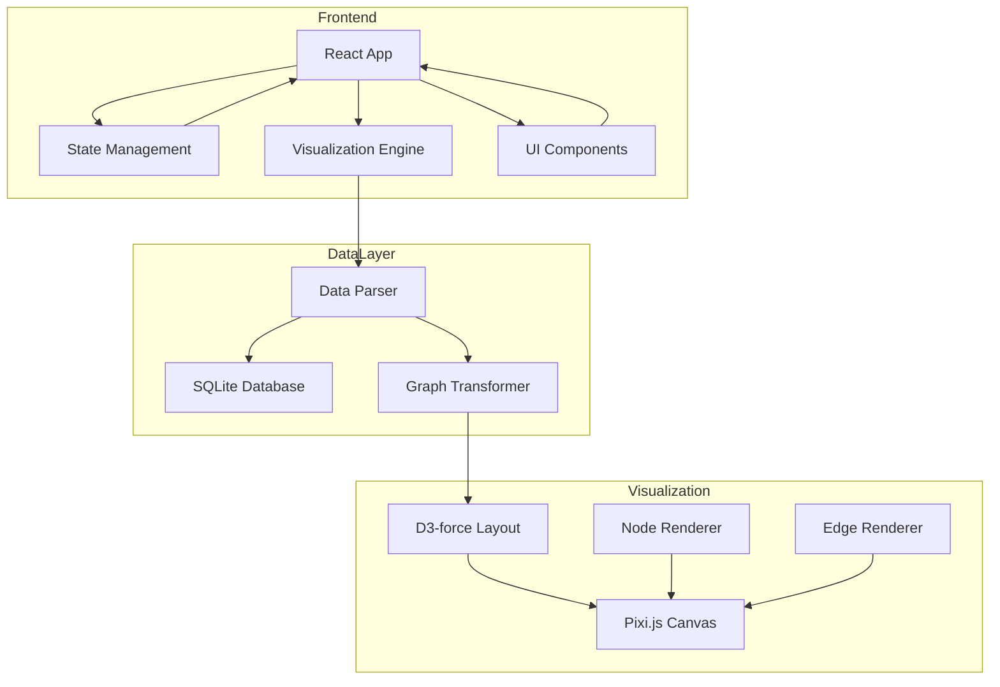

# 代码知识图谱可视化平台 技术架构文档

## 1. 架构设计

### 1.1 系统架构


## 2. 技术栈

### 2.1 前端框架
- **框架**：React 18 + TypeScript
- **构建工具**：Vite
- **样式方案**：Tailwind CSS
- **状态管理**：Zustand

### 2.2 可视化技术
- **图形引擎**：Pixi.js 7
- **布局算法**：D3-force
- **图表库**：Recharts
- **动画库**：Framer Motion

### 2.3 数据层
- **数据库**：SQLite 3
- **ORM**：sql.js (WebAssembly)
- **数据格式**：JSON

## 3. 路由定义

| 路由 | 目的 | 组件 |
|------|------|------|
| `/` | 重定向到 `/graph` | - |
| `/graph` | 主图谱视图 | GraphPage |
| `/graph/:fileId` | 特定文件详情 | FileDetailPage |
| `/stats` | 统计仪表板 | StatsPage |
| `/settings` | 设置页面 | SettingsPage |

## 4. 核心模块

### 4.1 可视化引擎 (VisualizationEngine)
```typescript
class VisualizationEngine {
  - canvas: PIXI.Application
  - forceSimulation: d3.ForceSimulation
  - nodes: Node[]
  - edges: Edge[]
  
  + initialize(container: HTMLElement)
  + loadGraphData(data: GraphData)
  + zoomIn() / zoomOut()
  + panTo(nodeId: string)
  + highlightPath(from: string, to: string)
  + destroy()
}
```

### 4.2 数据解析器 (DataParser)
```typescript
class DataParser {
  - db: SQL.Database
  
  + async loadDatabase(path: string)
  + async getAllNodes(): Promise<Node[]>
  + async getAllEdges(): Promise<Edge[]>
  + async searchNodes(query: string): Promise<Node[]>
  + async getNodeDetails(id: number): Promise<NodeDetail>
}
```

### 4.3 节点类型
```typescript
interface Node {
  id: string
  type: 'file' | 'class' | 'method' | 'component'
  label: string
  x?: number
  y?: number
  data: FileInfo | ClassInfo | MethodInfo | ComponentInfo
}

interface Edge {
  source: string
  target: string
  type: 'calls' | 'contains' | 'imports' | 'extends'
  weight?: number
}
```

## 5. 性能优化策略

### 5.1 渲染优化
- **LOD系统**：根据缩放级别调整节点细节
- **视口裁剪**：只渲染可见区域节点
- **批处理**：合并绘制调用
- **对象池**：复用Pixi.js显示对象

### 5.2 数据优化
- **增量加载**：分页加载大量节点
- **懒加载**：延迟加载详情数据
- **缓存**：本地缓存已加载的数据
- **Web Worker**：后台线程处理数据转换

### 5.3 交互优化
- **防抖搜索**：300ms防抖
- **虚拟列表**：长列表使用虚拟滚动
- **节流渲染**：拖拽时限制渲染频率

## 6. 文件结构

```
src/
├── components/
│   ├── GraphCanvas/         # Pixi.js画布组件
│   ├── ControlPanel/        # 左侧控制面板
│   ├── DetailPanel/         # 右侧详情面板
│   ├── StatsPanel/          # 统计面板
│   └── common/              # 通用组件
├── hooks/
│   ├── useGraph.ts          # 图谱状态管理
│   ├── useDatabase.ts       # 数据库操作
│   └── useVisualization.ts  # 可视化逻辑
├── utils/
│   ├── dataParser.ts        # 数据解析
│   ├── graphLayout.ts       # 布局算法
│   └── searchEngine.ts     # 搜索引擎
├── pages/
│   ├── GraphPage.tsx        # 主视图
│   └── StatsPage.tsx        # 统计页
└── App.tsx
```

## 7. 数据模型

### 7.1 ER图
```mermaid
erDiagram
    FILE ||--o{ CLASS : contains
    FILE ||--o{ METHOD : contains
    CLASS ||--o{ METHOD : contains
    METHOD }o--o{ METHOD : calls
    CLASS ||--o{ COMPONENT : nests
    CLASS ||--o{ CLASS : extends
```

### 7.2 数据类型
```typescript
interface FileInfo {
  id: number
  path: string
  hash: string
}

interface ClassInfo {
  id: number
  name: string
  fileId: number
  methods: MethodInfo[]
  components: ClassInfo[]
}

interface MethodInfo {
  id: number
  name: string
  classId: number | null
  fileId: number
  callers: number[]
  callees: number[]
}

interface ComponentInfo {
  id: number
  name: string
  fileId: number
  parentId: number | null
  children: ComponentInfo[]
}
```

## 8. API接口（如需后端）

### 8.1 数据查询
```
GET /api/graph
  Response: { nodes: Node[], edges: Edge[] }

GET /api/node/:id
  Response: NodeDetail

POST /api/search
  Body: { query: string, filters?: Filter[] }
  Response: Node[]
```

## 9. 部署架构

- **前端**：静态资源部署至CDN
- **数据库**：SQLite文件云存储
- **无需后端**：纯前端应用，数据本地处理
